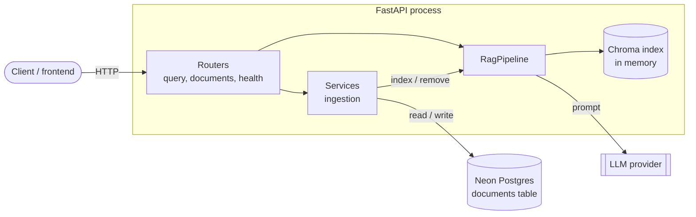
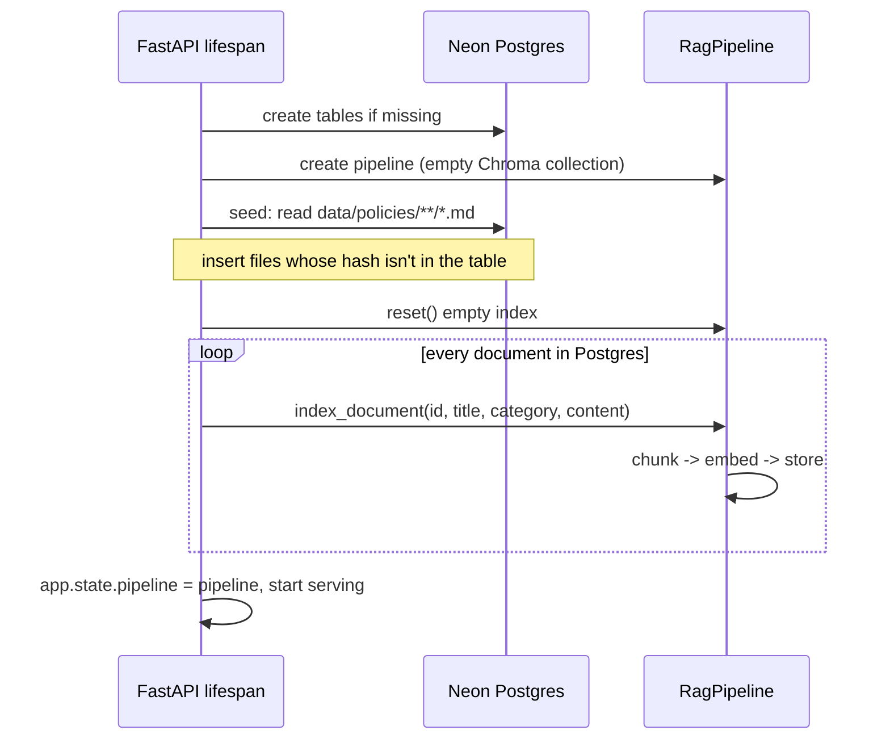
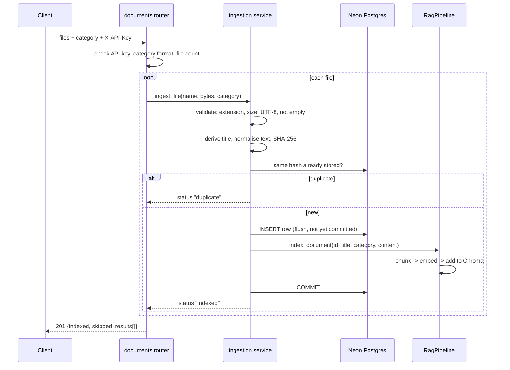

# Architecture and workflow

## 1. The big picture



Two stores, with different jobs:

| Store | Holds | Role |
|---|---|---|
| **Neon Postgres** | Full text of every document, title, category, hash, metadata | **Source of truth.** Durable. |
| **Chroma index** (in memory) | Chunk text + embedding vectors | **Derived data.** A search index rebuilt from Postgres at every startup. |

Because the index can always be rebuilt from Postgres, it can be lost without losing any data.

## 2. Project structure

```
policy-rag/
├── pyproject.toml            dependencies, CPU-torch config, entry point
├── .env.example              every setting, documented
├── data/policies/            seed .md files (sub-folder name = category)
├── docs/                     you are here
├── tests/
│   ├── conftest.py           SQLite + fake embeddings + fake LLM fixtures
│   └── test_api.py           endpoint tests
└── src/policy_rag/
    ├── settings.py           ONE Settings class used by both layers
    │
    ├── rag/                  THE PIPELINE (no HTTP, no SQL)
    │   ├── chunking.py       stage 1  split a document into chunks
    │   ├── embeddings.py     stage 2  text -> vectors
    │   ├── vector_store.py   stage 3-4  store vectors, similarity search (Chroma)
    │   ├── prompt.py         stage 5  retrieved chunks -> LLM prompt
    │   ├── generation.py     stage 6  call the LLM
    │   └── pipeline.py       stage 7  RagPipeline: wires stages together
    │
    └── api/                  THE WEB APPLICATION
        ├── main.py           app factory + startup/shutdown (lifespan)
        ├── dependencies.py   get_pipeline, require_admin (API-key check)
        ├── schemas.py        request/response models
        ├── routers/
        │   ├── query.py      POST /api/v1/query
        │   ├── documents.py  upload, list, get, delete
        │   └── health.py     GET /health
        ├── services/
        │   └── ingestion.py  validate -> store in Postgres -> index. Seeding + rebuild.
        └── db/
            ├── models.py     Document table
            ├── session.py    engine, pool, per-request session
            └── repository.py all SQL queries
```

## 3. How the RAG pipeline is integrated

The integration follows one rule: **dependencies point downward only.**

```
routers  ->  services  ->  RagPipeline  ->  chunking / embeddings / vector_store / prompt / generation
(HTTP)       (SQL + glue)   (RAG logic)
```

- `rag/` never imports anything from `api/`. It has no idea FastAPI or Postgres exist, so you can still call it from a script or notebook.
- `RagPipeline` is created **once** at startup and stored on `app.state.pipeline`. Routers get it through the `get_pipeline` dependency. One instance means the embedding model is loaded once and all requests share one index.
- Only the `ingestion` service talks to both Postgres and the pipeline. Routers never combine the two directly.

### What changed from the original lab script

| Lab script | Now | Why |
|---|---|---|
| Hard-coded documents / `.md` loader | Rows in Postgres | Documents can be added at runtime |
| `print()` everywhere | `logging` | Servers need log levels, not console output |
| Chunk all documents in one call | `chunk_document()` per document | Uploads index one document at a time |
| Chroma's built-in embedder for documents, SentenceTransformer for queries | Our `embed_texts` for **both** | One code path guarantees the same model on both sides |
| Constants in `config.py` | `Settings` from env | Configurable without code changes |
| Rebuilt the index for every question | Built once at startup, updated incrementally | Latency |
| Simulated LLM | `generate_answer()` via OpenAI-compatible API | Real answers |

## 4. Data model

`documents` table (Postgres):

| Column | Type | Notes |
|---|---|---|
| `id` | integer PK | Also used in chunk ids |
| `title` | varchar(255) | First `# Heading`, else filename |
| `category` | varchar(50), indexed | Used for filtering searches |
| `filename` | varchar(255) | Original upload name |
| `content` | text | Full document text |
| `content_hash` | varchar(64), **unique** | SHA-256 of normalised text; blocks duplicates |
| `source` | varchar(20) | `seed` or `upload` |
| `chunk_count` | integer | Set after indexing |
| `created_at` | timestamptz | Server default `now()` |

The link between the two stores is the **document id**. Each Chroma chunk has id `doc{id}_chunk_{n}` and metadata `{doc_id, title, category, chunk_index}`. Deleting a document removes chunks with `where={"doc_id": id}`.

## 5. Workflow A: startup

Runs once, in `main.lifespan`.



1. `init_db()` creates the `documents` table if it doesn't exist.
2. If `SEED_ON_STARTUP` is true, markdown files under `data/policies/` are inserted unless a document with the same hash exists. The sub-folder name becomes the category.
3. `rebuild_index()` empties the vector index and re-indexes **every** row in Postgres, including documents uploaded in earlier runs. Chunk counts are written back to the rows.
4. The app starts accepting requests.

## 6. Workflow B: upload a document

`POST /api/v1/documents/upload` (multipart, `X-API-Key` required)



Step by step:

1. **Auth and request checks.** The `require_admin` dependency compares `X-API-Key` to `ADMIN_API_KEY` in constant time. The category must match `^[a-z0-9][a-z0-9_-]{0,49}$`.
2. **Bounded read.** Each file is read up to `MAX_UPLOAD_BYTES + 1`, so an oversized upload is never fully loaded into memory.
3. **Validation** (`ingestion.prepare`): allowed extension, size, valid UTF-8, non-empty. Failures become `status: "rejected"` with a reason; the other files in the request still process.
4. **Normalise and hash.** Line endings are normalised and whitespace trimmed, then SHA-256 is computed. The same content with different line endings counts as a duplicate.
5. **Insert, then index, then commit.** The row is inserted with `flush()` to get its id, the pipeline chunks, embeds and stores it, and only then does the transaction commit.
6. **Searchable immediately.** No restart or reindex job is needed.

### Failure handling

| Failure | What happens |
|---|---|
| File invalid | `rejected` with a reason; nothing written |
| Same content already stored | `duplicate`; nothing written |
| Two identical files uploaded simultaneously | The unique constraint on `content_hash` rejects the loser, reported as `duplicate` |
| Embedding or Chroma error while indexing | Transaction **rolled back**, any partial chunks removed, error propagates (HTTP 500). No half-stored document |
| Process crashes after commit but before the response | Document is safely in Postgres; the startup rebuild indexes it |

## 7. Workflow C: ask a question

`POST /api/v1/query`

```mermaid
sequenceDiagram
    participant C as Client
    participant R as query router
    participant P as RagPipeline
    participant V as Chroma
    participant L as LLM
    C->>R: {question, top_k?, category?}
    R->>P: answer(question, top_k, category)
    P->>P: clean + embed question
    P->>V: nearest chunks (optional category filter)
    V-->>P: chunks + distances
    P->>P: similarity = 1 - distance; drop below MIN_SIMILARITY
    alt no chunks
        P-->>R: "couldn't find anything" (LLM not called)
    else chunks found
        P->>P: build prompt: sources + question
        P->>L: system prompt + user prompt
        L-->>P: answer text
    end
    R-->>C: {answer, sources[], model}
```

1. The question is whitespace-cleaned and embedded with the same model used for documents.
2. Chroma returns the `top_k` nearest chunks by cosine distance. `similarity = 1 - distance`.
3. Chunks below `MIN_SIMILARITY` are discarded.
4. If nothing remains, a fixed "nothing found" message is returned **without calling the LLM**, which saves cost and avoids invented answers.
5. Otherwise the prompt is built as `POLICIES: Source 1: <title> <text> ... QUESTION: ...`. The system prompt tells the model to answer only from those sources and say so when the answer isn't there.
6. The response includes `sources` (document id, title, similarity, excerpt) so a frontend can show where the answer came from.
7. If the LLM call fails, the client gets **502** (details stay in the server log).

## 8. Workflow D: delete a document

`DELETE /api/v1/documents/{id}` (admin)

1. Delete the row from Postgres and commit.
2. Remove its chunks from Chroma by `doc_id`.

Postgres goes first because it's the source of truth. If step 2 fails, the stale chunks are gone after the next startup rebuild.

## 9. Limitations and scaling path

| Limitation | Why | When it matters | Fix |
|---|---|---|---|
| **Single worker only** | The Chroma index is per-process memory. An upload handled by worker A is invisible to worker B | Running `--workers N` or multiple replicas | Move vectors into Postgres with **pgvector** (Neon supports it) so every process shares one index, or run Chroma as a server |
| **Startup time grows with data** | Every start re-embeds all documents | Thousands of documents | Same pgvector move (embeddings persist), or a persistent Chroma directory |
| **Uploads block the request** | Chunking and embedding happen inline | Large files or many files per request | Background task/queue returning a job id |
| **Shared-secret auth** | One key for all admins; query and list endpoints are public | Real users, sensitive policies | Real authentication (OAuth/JWT), per-user roles, authenticate `/query` too |
| **`create_all` for schema** | No migration history | Schema changes after first deploy | Alembic migrations |
| **No rate limiting** | Each query costs an LLM call | Public exposure | Reverse-proxy or middleware limits |
| **Text only** | Only `.md`/`.markdown`/`.txt` | You need PDFs or Word files | Add a text-extraction step in `ingestion.prepare` (e.g. `pypdf`) |

## 10. Extending it

| Goal | Where to change |
|---|---|
| Different chunking strategy | `rag/chunking.py` (`chunk_document` must keep returning `Chunk` objects) |
| Different LLM / provider | `LLM_*` env vars, or replace `generate_answer` in `rag/generation.py` |
| Better prompt / answer style | `rag/prompt.py` |
| Hybrid keyword + vector search | `rag/vector_store.py` and `RagPipeline.retrieve` |
| New endpoint | New file in `api/routers/`, include it in `api/main.py` |
| New document field | `api/db/models.py`, `schemas.py`, and `ingestion.py` (add a migration once you adopt Alembic) |
